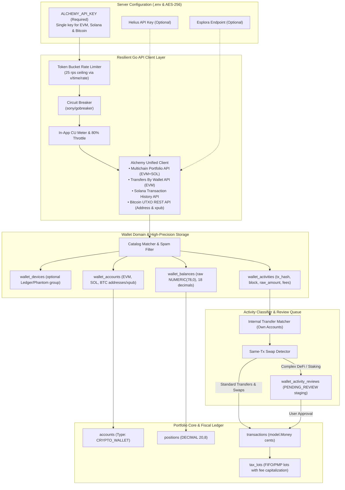

# Free-First Crypto Wallet Synchronization Implementation Plan (Alchemy-First / Single-Key Architecture)

> **For agentic workers:** REQUIRED SUB-SKILL: Use superpowers:subagent-driven-development (recommended) or superpowers:executing-plans to implement this plan task-by-task. Steps use checkbox (`- [ ]`) syntax for tracking.

**Goal:** Deliver automated, zero-subscription (€0/month) on-chain crypto wallet synchronization for Sigma Finance across Ethereum, Base, Arbitrum, Optimism, Polygon, Solana, and Bitcoin using an **Alchemy-first, single-key architecture** with full historical backfill to genesis, multi-chain hardware/software wallet grouping, smart swap classification with a DeFi review queue, Bitcoin xpub/single-address support, automated internal transfer pairing, spam airdrop filtering, and an in-app Compute Unit budget tracker with soft throttling.

**Architecture:** 
1. **One Provider, One Key Default**: An instance-level `ALCHEMY_API_KEY` (configured in `.env` and encrypted in `sync_credentials`) provides access to all seven networks:
   - **EVM + Solana Balances**: Alchemy Multichain Portfolio API (`POST https://api.g.alchemy.com/data/v1/{apiKey}/assets/tokens/balances/by-address`).
   - **EVM Historical Transfers**: Alchemy Transfers By Wallet API (`POST https://[network]-mainnet.g.alchemy.com/v2/{apiKey}` with `alchemy_getAssetTransfers`).
   - **Solana Transaction History**: Alchemy Solana Transaction History API (`get-transactions-for-address`).
   - **Bitcoin Balances & Activity**: Alchemy Bitcoin UTXO REST API (`get-address`, `get-address-transactions`, `get-xpub` for HD wallet derivation; requires Bitcoin UTXO enabled in Alchemy app dashboard).
2. **Provider Communication Tooling & Resilience**:
   - `net/http` persistent connection pooling.
   - `golang.org/x/time/rate`: Token bucket rate limiter strictly capping requests at 25 rps.
   - `github.com/sony/gobreaker`: Circuit breaker to guard against provider outages or network degradation.
   - `github.com/btcsuite/btcd/btcutil`: Lightweight address/xpub parsing and validation (Bech32, P2PKH, P2SH, xpub/zpub).
3. **Multi-Chain Hardware & Software Wallet Containers**: Users can import standalone addresses or group multi-chain addresses under a parent wallet container (e.g. "Ledger Nano X" or "Phantom" containing EVM + Solana + Bitcoin addresses). Each chain address maps cleanly to an `Account` (Type: `CRYPTO_WALLET`) under the target Portfolio.
4. **Smart Classification & Staged Review Queue**: 
   - Standard incoming/outgoing transfers are auto-classified into `TRANSFER_IN` / `TRANSFER_OUT` / `FEE`.
   - Token swaps within the same transaction hash (outgoing token A + incoming token B) are automatically paired into `SELL` / `BUY` transactions with matched cost basis.
   - Complex or multi-step DeFi interactions (liquidity pool mints, staking, bridge transactions) are flagged as `PENDING_REVIEW` in a staging review queue for one-click user confirmation before generating tax lots.
5. **Cross-Wallet Internal Transfer Matching**: When an outgoing transfer destination address belongs to another tracked wallet or account of the same user, it is automatically paired as an Internal Transfer, carrying over cost basis and holding periods without triggering an artificial taxable disposal.
6. **Spam & Airdrop Filtering**: Tokens without recognized metadata in Sigma's Trust Wallet Assets catalog or without market pricing are marked as "Unverified / Potential Spam" and placed into a collapsed "Hidden Tokens" shelf to avoid distorting portfolio valuations.
7. **Gas Fee Fiscal Accounting**:
   - For swaps and trades: network fees are capitalized into the asset's acquisition cost basis or deducted from net disposal proceeds.
   - For standalone transfers and contract calls: network gas is recorded as a native asset disposal (`FEE`) so native balances (ETH, SOL, BTC) reconcile precisely.
8. **In-App Compute Unit (CU) Tracker & Soft Throttle**:
   - Monthly usage is tracked in `sigma_finance.wallet_sync_states`.
   - Provider settings displays a visual gauge ("Monthly CU Usage: 1.2M / 30M CUs").
   - If monthly usage exceeds 80% (24M CUs), automated 12-hour background polling is automatically paused to guarantee remaining capacity for manual syncs, safeguarding the €0/month guarantee.
9. **Full Historical Backfill to Genesis**: Pagination loops crawl transfer history back to the first transaction on-chain, respecting rate-limit backoffs (25 rps ceiling) and logging progress.
10. **Precision Decoupling & Partial-Failure Invariant**: Exact token amounts (up to 78 digits / 18 decimals) are preserved in dedicated `wallet_balances` and `wallet_activities` tables. When Alchemy returns partial errors (HTTP 200 with omitted or error-flagged chains), existing wallet balances for omitted chains are protected and never overwritten with zeros.

**Tech Stack:** Go 1.25, Bun ORM, PostgreSQL, Fiber v2, gqlgen, AES-256-GCM, `sony/gobreaker`, `golang.org/x/time/rate`, `btcutil`, React 18, Vite, Apollo Client, Tailwind CSS.

---

## Global Constraints

- **Live Key Prerequisite**: Live `ALCHEMY_API_KEY` configured in `.env` on the server before Phase 1 qualification begins.
- **Zero-Cost Operating Budget (€0/month)**: Free tier compliance across the shared 30M Compute Units (CU) / month pool (~1M CU/day budget), 25 requests/sec, guarded by an in-app soft throttle at 24M CUs.
- **Security & Privacy**: Read-only public addresses and public keys only. No private keys or seed phrases. Sensitive metadata (xpub) encrypted at rest using AES-256-GCM.
- **Precision Integrity**: Preserve exact token units in dedicated wallet tables (`raw_balance NUMERIC(78,0)` / `formatted_quantity DECIMAL(36,18)`) without loss of precision before classification into portfolio positions (`DECIMAL(20,8)`).
- **Graceful Degradation**: Optional fallback providers (Helius for deep Solana history, Esplora for self-hosted/mempool.space Bitcoin REST) can be connected at any time without altering core data schemas.

---

## Finalized Decisions Matrix (Resolved via /grill-me)

| Area | Decision | Implementation Details |
| :--- | :--- | :--- |
| **API Client Tooling** | Typed Go HTTP + Circuit Breaker | Native typed Go client with `sony/gobreaker` and `x/time/rate` (25 rps limit); `btcutil` for address/xpub validation. |
| **Wallet Entity Mapping** | Hybrid: Multi-Chain Container + Single Address | Parent `wallet_devices` (optional container like "Ledger") groups multiple `wallet_accounts`. Each `wallet_account` maps to an `Account` (`CRYPTO_WALLET`) in portfolio. |
| **Spam / Scam Airdrops** | Catalog Matching + Hidden Shelf | Unmatched/zero-liquidity tokens flagged as potential spam and hidden in a collapsed UI section; excluded from portfolio net worth. |
| **Gas Fee Accounting** | Fiscal Capitalization + Standalone Fee | Swaps roll fee into trade cost basis/proceeds; standalone transfers record a `FEE` disposal of native coin. |
| **Cross-Wallet Transfers** | Automatic Own-Account Matching | Outgoing transfers to owned addresses auto-pair with incoming transfers as Internal Transfers without taxable realization. |
| **Activity Classification** | Smart Classifier + Review Queue | Auto-classify simple transfers and matched swaps (same tx hash); flag complex DeFi/LP interactions as `PENDING_REVIEW` in a staging table. |
| **Historical Backfill** | Genesis Backfill | Full cursor pagination back to address creation, with 25 rps rate limiting and progress logging. |
| **Bitcoin Import** | Single Address AND xpub/zpub | Supports `bc1q...`, `1...` or `xpub`/`ypub`/`zpub`. For xpub, calls Alchemy `get-xpub` for automated address and UTXO discovery. |
| **Sync Cadence & Throttling** | Dual Mode (12h Cron + 5min Cooldown) + 80% Soft Throttle | Background sync runs every 12h; manual sync has 5-minute cooldown; background sync auto-pauses at 24M CU usage (80% quota). |
| **Portfolio Allocation** | Target Portfolio Assignment | Devices and accounts are created in a primary portfolio, with per-chain account re-allocation supported. |
| **Qualification Key** | Live Key Required Immediately | Halts qualification until `ALCHEMY_API_KEY` is present in server `.env`. |

---

## System Architecture



---

## Phase 1: Research & Provider Qualification (Deliverables 1, 2, 3)

### Task 1: Alchemy Unified Live Qualification Benchmark
**Goal**: Validate actual responses, rate limits, pagination depth, and credit consumption using a live `ALCHEMY_API_KEY` against representative public addresses across all 7 chains.

**Prerequisite**: Ensure `ALCHEMY_API_KEY` is defined in `.env`.

**Files:**
- Create: `server/cmd/tools/wallet_qualification/main.go`
- Create: `server/cmd/tools/wallet_qualification/alchemy_portfolio.go`
- Create: `server/cmd/tools/wallet_qualification/alchemy_transfers.go`
- Create: `server/cmd/tools/wallet_qualification/alchemy_solana.go`
- Create: `server/cmd/tools/wallet_qualification/alchemy_bitcoin.go`
- Create: `server/cmd/tools/wallet_qualification/partial_failure_test.go`
- Output: `docs/superpowers/specs/2026-10-28-wallet-provider-matrix.md`

- [ ] **Step 1: Check `ALCHEMY_API_KEY` presence in server environment**
  - Verify key is non-empty; fail fast with clear instructions if missing.
- [ ] **Step 2: Benchmark Alchemy Multichain Portfolio API**
  - Call `POST https://api.g.alchemy.com/data/v1/{apiKey}/assets/tokens/balances/by-address` for Ethereum, Base, Arbitrum, Optimism, Polygon, and Solana.
  - Assert: Native coin + ERC-20 / SPL token formatting, decimals extraction, CU usage.
- [ ] **Step 3: Benchmark Alchemy Transfers By Wallet API across 5 EVM Networks**
  - Call `alchemy_getAssetTransfers` with recursive `pageKey` pagination back multiple pages.
  - Assert: ERC-20 transfer parsing, internal transfer availability (ETH/Base/Polygon vs Arbitrum/Optimism).
- [ ] **Step 4: Benchmark Alchemy Solana Transaction History API**
  - Test `get-transactions-for-address` pagination and token balance delta decoding.
- [ ] **Step 5: Benchmark Alchemy Bitcoin UTXO API (Single Address & xpub)**
  - Test `get-address` and `get-xpub` endpoints.
  - Assert: Address UTXO aggregation, change address discovery for xpub, and error behavior if Bitcoin UTXO is not toggled in dashboard.
- [ ] **Step 6: Benchmark Partial-Failure Handling**
  - Test response parser when one chain is forced to timeout/fail: confirm that successful chains are extracted and failed chains are flagged without data loss.
- [ ] **Step 7: Produce Qualification Matrix Document**
  - Save full benchmark results to `docs/superpowers/specs/2026-10-28-wallet-provider-matrix.md`.

---

## Phase 2: Database Schema & Domain Modeling

### Task 2: Dedicated Wallet Storage, Multi-Chain Containers, CU Tracking & Review Queue
**Goal**: Create database tables and Go models for wallet containers, accounts, raw holdings, raw activities, CU quota tracking, and the DeFi review staging queue.

**Files:**
- Create: `server/cmd/bun/migrations/64102026_create_wallet_sync_tables.go`
- Create: `server/internal/domain/model/wallet.go`
- Create: `server/internal/domain/model/wallet_test.go`
- Modify: `server/internal/domain/model/account.go` (Add `AccountTypeCryptoWallet = "CRYPTO_WALLET"`)

**Schema Highlights:**
```sql
-- 1. Optional Parent Container (for Hardware / Multi-Chain Wallets like Ledger, Trezor, Phantom)
CREATE TABLE sigma_finance.wallet_devices (
    id UUID PRIMARY KEY DEFAULT gen_random_uuid(),
    user_id UUID NOT NULL REFERENCES sigma_finance."user"(id) ON DELETE CASCADE,
    name VARCHAR(100) NOT NULL, -- e.g. "Ledger Nano X", "Phantom Personal"
    device_type VARCHAR(50) NOT NULL DEFAULT 'SOFTWARE', -- HARDWARE, SOFTWARE, STANDALONE
    created_at TIMESTAMP WITH TIME ZONE DEFAULT NOW(),
    updated_at TIMESTAMP WITH TIME ZONE DEFAULT NOW()
);

-- 2. Wallet Accounts (One per chain address or xpub)
CREATE TABLE sigma_finance.wallet_accounts (
    id UUID PRIMARY KEY DEFAULT gen_random_uuid(),
    user_id UUID NOT NULL REFERENCES sigma_finance."user"(id) ON DELETE CASCADE,
    device_id UUID REFERENCES sigma_finance.wallet_devices(id) ON DELETE SET NULL,
    account_id UUID REFERENCES sigma_finance.accounts(id) ON DELETE SET NULL,
    network VARCHAR(50) NOT NULL, -- ETHEREUM, BASE, ARBITRUM, OPTIMISM, POLYGON, SOLANA, BITCOIN
    address_or_xpub VARCHAR(255) NOT NULL,
    is_xpub BOOLEAN NOT NULL DEFAULT FALSE,
    label VARCHAR(100),
    is_active BOOLEAN NOT NULL DEFAULT TRUE,
    last_sync_at TIMESTAMP WITH TIME ZONE,
    sync_cursor VARCHAR(255),
    history_status VARCHAR(50) NOT NULL DEFAULT 'PENDING', -- PENDING, IN_PROGRESS, SYNCED, ERROR
    last_sync_error TEXT,
    created_at TIMESTAMP WITH TIME ZONE DEFAULT NOW(),
    updated_at TIMESTAMP WITH TIME ZONE DEFAULT NOW()
);
CREATE UNIQUE INDEX idx_wallet_accounts_user_net_addr ON sigma_finance.wallet_accounts(user_id, network, address_or_xpub);

-- 3. Dedicated Wallet Balances (Exact uint256 / 78-digit precision + Spam Shelf)
CREATE TABLE sigma_finance.wallet_balances (
    id UUID PRIMARY KEY DEFAULT gen_random_uuid(),
    wallet_account_id UUID NOT NULL REFERENCES sigma_finance.wallet_accounts(id) ON DELETE CASCADE,
    instrument_id UUID REFERENCES sigma_finance.instruments(id) ON DELETE SET NULL,
    token_address VARCHAR(255), -- NULL for native coins (ETH, SOL, BTC)
    symbol VARCHAR(50) NOT NULL,
    name VARCHAR(255),
    decimals INT NOT NULL DEFAULT 18,
    raw_balance NUMERIC(78, 0) NOT NULL DEFAULT 0,
    formatted_quantity DECIMAL(36, 18) NOT NULL DEFAULT 0,
    is_spam BOOLEAN NOT NULL DEFAULT FALSE,
    is_hidden BOOLEAN NOT NULL DEFAULT FALSE,
    is_stale BOOLEAN NOT NULL DEFAULT FALSE,
    last_updated_at TIMESTAMP WITH TIME ZONE DEFAULT NOW()
);
CREATE UNIQUE INDEX idx_wallet_balances_wallet_token ON sigma_finance.wallet_balances(wallet_account_id, COALESCE(token_address, 'NATIVE'));

-- 4. Dedicated Raw Activities (with Internal Transfer link)
CREATE TABLE sigma_finance.wallet_activities (
    id UUID PRIMARY KEY DEFAULT gen_random_uuid(),
    wallet_account_id UUID NOT NULL REFERENCES sigma_finance.wallet_accounts(id) ON DELETE CASCADE,
    tx_hash VARCHAR(255) NOT NULL,
    block_or_slot BIGINT NOT NULL,
    executed_at TIMESTAMP WITH TIME ZONE NOT NULL,
    from_address VARCHAR(255) NOT NULL,
    to_address VARCHAR(255) NOT NULL,
    token_address VARCHAR(255),
    raw_amount NUMERIC(78, 0) NOT NULL DEFAULT 0,
    decimals INT NOT NULL DEFAULT 18,
    formatted_amount DECIMAL(36, 18) NOT NULL DEFAULT 0,
    fee_amount NUMERIC(78, 0) NOT NULL DEFAULT 0,
    provider_source VARCHAR(50) NOT NULL DEFAULT 'ALCHEMY',
    raw_metadata JSONB,
    matched_internal_activity_id UUID REFERENCES sigma_finance.wallet_activities(id) ON DELETE SET NULL,
    classified_transaction_id UUID REFERENCES sigma_finance.transactions(id) ON DELETE SET NULL,
    created_at TIMESTAMP WITH TIME ZONE DEFAULT NOW()
);
CREATE UNIQUE INDEX idx_wallet_activities_wallet_tx ON sigma_finance.wallet_activities(wallet_account_id, tx_hash, COALESCE(token_address, 'NATIVE'));

-- 5. Staging Review Queue for Complex DeFi Transactions
CREATE TABLE sigma_finance.wallet_activity_reviews (
    id UUID PRIMARY KEY DEFAULT gen_random_uuid(),
    wallet_activity_id UUID NOT NULL REFERENCES sigma_finance.wallet_activities(id) ON DELETE CASCADE,
    user_id UUID NOT NULL REFERENCES sigma_finance."user"(id) ON DELETE CASCADE,
    review_status VARCHAR(30) NOT NULL DEFAULT 'PENDING', -- PENDING, APPROVED, DISMISSED
    suggested_type VARCHAR(30) NOT NULL, -- BUY, SELL, TRANSFER_IN, TRANSFER_OUT, FEE, IGNORE
    notes TEXT,
    created_at TIMESTAMP WITH TIME ZONE DEFAULT NOW(),
    updated_at TIMESTAMP WITH TIME ZONE DEFAULT NOW()
);
CREATE INDEX idx_wallet_activity_reviews_user_status ON sigma_finance.wallet_activity_reviews(user_id, review_status);

-- 6. Compute Unit (CU) Quota Meter Table
CREATE TABLE sigma_finance.wallet_cu_tracking (
    id UUID PRIMARY KEY DEFAULT gen_random_uuid(),
    billing_month VARCHAR(7) NOT NULL, -- e.g. "2026-10"
    compute_units_consumed BIGINT NOT NULL DEFAULT 0,
    is_throttled BOOLEAN NOT NULL DEFAULT FALSE,
    updated_at TIMESTAMP WITH TIME ZONE DEFAULT NOW()
);
CREATE UNIQUE INDEX idx_wallet_cu_billing_month ON sigma_finance.wallet_cu_tracking(billing_month);
```

- [ ] **Step 1: Write failing domain model validation tests**
  - Test address and xpub formats using `btcutil` (EVM `0x`, Solana base58, Bitcoin Bech32/Base58, `xpub...`).
  - Test raw balance arithmetic, spam flag toggling, and CU quota increments.
- [ ] **Step 2: Implement `wallet.go` models and Bun annotations**
- [ ] **Step 3: Implement migration `64102026_create_wallet_sync_tables.go` and run migration**

---

## Phase 3: Blockchain Provider Adapters & Client Subsystem

### Task 3: Unified Alchemy Client, Rate Limiter, CU Tracker & Circuit Breaker
**Goal**: Build the unified Alchemy multi-chain client in Go Clean Architecture supporting EVM, Solana, and Bitcoin (address + xpub), with partial-failure isolation, 25 rps rate limiting (`x/time/rate`), in-app CU tracking with 80% soft throttle, and circuit breaker (`sony/gobreaker`).

**Files:**
- Create: `server/internal/service/sync/blockchain/adapter.go`
- Create: `server/internal/service/sync/blockchain/alchemy/client.go`
- Create: `server/internal/service/sync/blockchain/alchemy/cu_tracker.go`
- Create: `server/internal/service/sync/blockchain/alchemy/portfolio.go`
- Create: `server/internal/service/sync/blockchain/alchemy/transfers.go`
- Create: `server/internal/service/sync/blockchain/alchemy/solana.go`
- Create: `server/internal/service/sync/blockchain/alchemy/bitcoin.go`
- Create: `server/internal/service/sync/blockchain/alchemy/client_test.go`

- [ ] **Step 1: Implement unit tests with mocked Alchemy JSON payloads**
  - Test partial error parsing, xpub response mapping, token transfer pagination, CU tracking increments, and 80% quota throttling.
- [ ] **Step 2: Implement `AlchemyClient` transport & rate limiter**
  - Integrate `rate.NewLimiter(rate.Limit(25), 25)` and `gobreaker.CircuitBreaker`.
- [ ] **Step 3: Implement Multichain Portfolio Client**
  - `GetTokenBalancesByAddress(ctx context.Context, addresses []string, networks []string)`
- [ ] **Step 4: Implement Transfers By Wallet Client**
  - `GetAssetTransfers(ctx context.Context, network string, address string, pageKey string)`
- [ ] **Step 5: Implement Solana & Bitcoin Clients**
  - `GetSolanaTransactions(ctx context.Context, address string, until string)`
  - `GetBitcoinAddress(ctx context.Context, address string)`
  - `GetBitcoinXpub(ctx context.Context, xpub string)`

---

## Phase 4: Sync Orchestration & Smart Classification

### Task 4: Ingestion, Full Genesis Backfill, Spam Filter & Smart Classifier
**Goal**: Crawl full history back to genesis, ingest raw balances with spam filtering, auto-classify swaps/internal transfers/fees, and stage complex DeFi interactions in the review queue.

**Files:**
- Create: `server/internal/service/sync/blockchain/service.go`
- Create: `server/internal/service/sync/blockchain/spam_filter.go`
- Create: `server/internal/service/sync/blockchain/classifier.go`
- Create: `server/internal/service/sync/blockchain/classifier_test.go`
- Create: `server/internal/service/sync/blockchain/cron.go`
- Modify: `server/internal/service/sync/service.go`

- [ ] **Step 1: Implement full genesis pagination loop**
  - Paginate through all historical transfers back to the initial transaction.
  - Enforce 25 rps rate limit and CU tracking; log progress every 100 transfers.
- [ ] **Step 2: Implement holding reconciliation with Spam Filter**
  - Verify tokens against Trust Wallet Assets catalog and CoinMarketCap.
  - If token has no market data or is flagged as scam: set `is_spam = true, is_hidden = true`.
  - Zero out absent non-spam tokens only if chain sync succeeded completely (never on partial failure).
- [ ] **Step 3: Implement Smart Activity Classifier (`classifier.go`)**
  - Cross-wallet internal transfers: check if `to_address` matches an owned `wallet_account`. If yes, mark as `TRANSFER_OUT` / `TRANSFER_IN` pair without taxable disposal.
  - Swaps: Group movements by `tx_hash`. If 1 token moves out and 1 token moves in, classify as `SELL` (token A) and `BUY` (token B) at execution time, capitalizing network fee into cost basis.
  - Standalone transfers: record network gas as separate `FEE` disposal of native coin.
  - Complex DeFi / contract calls: Insert into `wallet_activity_reviews` with status `PENDING_REVIEW`.
- [ ] **Step 4: Implement 12-hour background cron worker with 80% CU soft throttle + manual sync 5-minute cooldown**

---

## Phase 5: GraphQL Schema & Review Queue Resolvers

### Task 5: GraphQL API Layer
**Goal**: Expose wallet container management, address import, sync triggers, CU meter query, spam visibility toggles, and review queue resolution mutations.

**Files:**
- Create: `server/internal/handler/graphql/schema/wallet.graphqls`
- Modify: `server/internal/handler/graphql/resolver/wallet.resolvers.go`
- Modify: `server/graph/schema.graphqls`

**GraphQL Schema:**
```graphql
enum BlockchainNetwork {
  ETHEREUM
  BASE
  ARBITRUM
  OPTIMISM
  POLYGON
  SOLANA
  BITCOIN
}

type WalletDevice {
  id: ID!
  name: String!
  deviceType: String!
  accounts: [WalletAccount!]!
}

type WalletAccount {
  id: ID!
  network: BlockchainNetwork!
  addressOrXpub: String!
  isXpub: Boolean!
  label: String
  lastSyncAt: Time
  historyStatus: String!
  lastSyncError: String
  balances(includeSpam: Boolean): [WalletBalance!]!
}

type WalletBalance {
  symbol: String!
  name: String
  decimals: Int!
  rawBalance: String!
  formattedQuantity: Float!
  tokenAddress: String
  isSpam: Boolean!
  isHidden: Boolean!
  isStale: Boolean!
  instrument: Instrument
}

type WalletCUUsage {
  billingMonth: String!
  consumedUnits: Int!
  maxQuota: Int!
  isThrottled: Boolean!
}

type WalletActivityReview {
  id: ID!
  activity: WalletActivity!
  suggestedType: String!
  reviewStatus: String!
  notes: String
}

extend type Query {
  walletDevices: [WalletDevice!]!
  walletCUUsage: WalletCUUsage!
  pendingWalletReviews(portfolioId: ID!): [WalletActivityReview!]!
}

extend type Mutation {
  addWalletAccount(network: BlockchainNetwork!, addressOrXpub: String!, label: String, deviceId: ID, portfolioId: ID!): WalletAccount!
  createWalletDevice(name: String!, deviceType: String!): WalletDevice!
  removeWalletAccount(id: ID!): Boolean!
  triggerWalletSync(id: ID!): SyncRun!
  toggleSpamToken(balanceId: ID!, isHidden: Boolean!): Boolean!
  resolveWalletReview(reviewId: ID!, action: String!, customType: String): Boolean!
  configureAlchemyKey(apiKey: String!): Boolean!
}
```

- [ ] **Step 1: Add schema file and run `gqlgen generate`**
- [ ] **Step 2: Implement resolvers with portfolio ownership validation**
- [ ] **Step 3: Write GraphQL integration tests**

---

## Phase 6: Frontend Wallet Management, CU Gauge & Review Queue UI

### Task 6: React Components, Multi-Chain Device Modal & Review Banner
**Goal**: Deliver a polished UI for adding single addresses or multi-chain devices (Ledger/Phantom), viewing balances with spam filters, monitoring the CU quota gauge, and approving staged DeFi transactions.

**Files:**
- Create: `src/features/wallets/components/AddWalletDialog.tsx`
- Create: `src/features/wallets/components/WalletListCard.tsx`
- Create: `src/features/wallets/components/DeFiReviewQueueBanner.tsx`
- Create: `src/features/wallets/components/AlchemySettingsCard.tsx`
- Create: `src/features/wallets/components/CUUsageGauge.tsx`
- Create: `src/features/wallets/graphql/wallet.graphql`
- Modify: `src/features/accounts/components/AccountList.tsx`

- [ ] **Step 1: Generate Apollo hooks from `.graphql` definitions**
- [ ] **Step 2: Build `AlchemySettingsCard` with `CUUsageGauge`**
  - Shows "Monthly Compute Units: X / 30,000,000" with color status (green <60%, yellow 60-80%, red >80% throttled).
  - Include dashboard setup tip ("Enable Bitcoin UTXO in Alchemy dashboard").
- [ ] **Step 3: Build `AddWalletDialog`**
  - Tabs: "Single Address" vs "Multi-Chain Device (Ledger / Phantom)".
  - Bitcoin field accepts both single address (`bc1q...`) and extended public key (`xpub/ypub/zpub`).
- [ ] **Step 4: Build `DeFiReviewQueueBanner`**
  - Shows pending complex transactions with 1-click "Approve" or "Dismiss".
- [ ] **Step 5: Run frontend test suite (`pnpm test`)**

---

## Verification Plan

### Automated Tests
1. **Domain & Adapter Tests**:
   ```bash
   go test -v ./server/internal/domain/model/... -run "TestWallet.*"
   go test -v ./server/internal/service/sync/blockchain/...
   ```
2. **Classifier, Spam Filter & Reconciliation Tests**:
   ```bash
   go test -v ./server/internal/service/sync/blockchain/... -run "TestClassifier.*"
   go test -v ./server/internal/service/sync/... -run "TestWalletSync.*"
   ```
3. **Frontend Tests**:
   ```bash
   pnpm test
   ```

### Manual Verification
1. Configure `ALCHEMY_API_KEY` in `.env` and verify status indicators show green for all 7 networks.
2. Add a multi-chain wallet (e.g. "Ledger") containing an Ethereum address and a Bitcoin xpub.
3. Verify full historical genesis backfill completes and displays progress without hitting 429 errors.
4. Verify token swap detection pairs outgoing and incoming assets into matching Buy/Sell entries with fee capitalization.
5. Transfer funds between two owned wallets on-chain -> verify automatic Internal Transfer matching without artificial tax lot gain.
6. Verify unsolicited airdrops are classified under "Hidden Tokens" and excluded from total portfolio valuation.
7. Verify the Compute Unit gauge updates in Provider Settings after sync runs.
8. Rebuild and restart backend container:
   ```bash
   docker compose build server && docker compose up -d server
   ```
