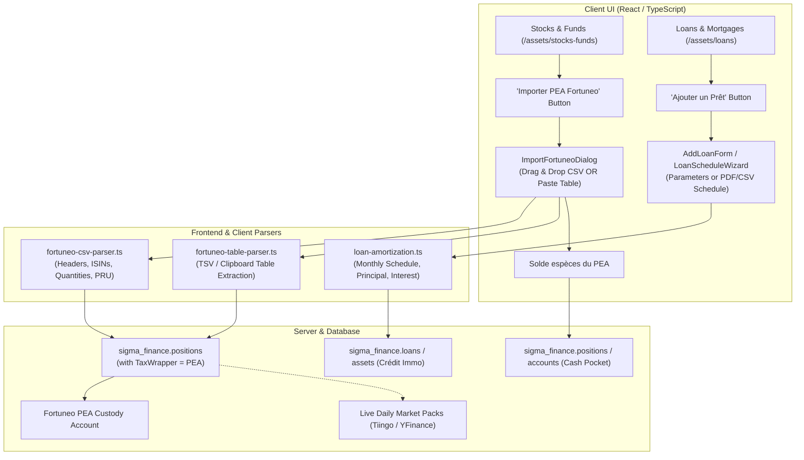

# Phase 1: 1-Click French Assets Importer (Fortuneo PEA & Caisse d'Épargne Crédit Immo)

> **For agentic workers:** REQUIRED SUB-SKILL: Use superpowers:subagent-driven-development (recommended) or superpowers:executing-plans to implement this plan task-by-task. Steps use checkbox (`- [ ]`) syntax for tracking.

**Goal:** Provide a 100% free, zero-maintenance, zero-scraper breakdown solution for French banking assets excluded from DSP2 Open Banking:
1. **Fortuneo PEA:** Dual-mode fast importer (Drag & Drop CSV OR direct Copy-Paste of the portfolio table) + cash pocket input, saving positions with auto-refreshing live market prices.
2. **Caisse d'Épargne Crédit Immo:** 1-minute key parameters form (capital, rate, insurance, duration) generating the exact month-by-month amortization schedule + optional PDF/CSV import, linked to real estate assets.

*(Note: Phase 2 will implement the optional Woob Sidecar Docker container for users desiring automated background scraping).*

---

## Decisions Locked in `/grill-me`

1. **Rollout Order:** Phase 1 first (1-Click CSV/text import + Crédit Immo direct setup) for immediate, robust functionality, then Phase 2 (Woob background sidecar).
2. **Fortuneo PEA Input:** Dual input mode — Drag & Drop CSV file OR Copy-Paste the portfolio table from the Fortuneo web page.
3. **PEA Cash Pocket:** Include a "Solde espèces disponible" field directly in the modal so cash and securities are saved together in one step.
4. **Crédit Immo:** 1-minute key parameters form (capital, rate, insurance, duration, start date) with auto-generated amortization schedule + optional PDF/CSV import.

---

## Proposed Changes

---

### Component 1: Fortuneo PEA Dual Importer (CSV & Paste)

#### [NEW] `client/src/lib/parsers/fortuneo-portfolio-parser.ts`
- Functions:
  - `parseFortuneoCSV(content: string)`: Handles CSV with semicolons or commas, french number formats (`1 250,50 €` -> `1250.50`), extracts `ISIN`, `name`, `quantity`, `averagePrice` (PRU), `lastPrice`, `valuation`.
  - `parseFortuneoClipboard(text: string)`: Handles direct copy-paste from Fortuneo web account view (tab-separated or multi-line formatted rows).
  - Normalizes ticker symbols (e.g. `CW8`, `WPEA`, `ESE`, `PAASI`, `LQQ`).

#### [NEW] `client/src/lib/parsers/__tests__/fortuneo-portfolio-parser.test.ts`
- Unit tests with authentic Fortuneo export samples (both CSV and clipboard text).

#### [NEW] `client/src/components/assets/stocks-funds/ImportFortuneoDialog.tsx`
- Modal featuring:
  - Tabs: **"Fichier CSV"** (Drag & Drop zone) and **"Copier-Coller"** (Textarea with instant preview).
  - **"Solde espèces du PEA"** input (e.g. `1 450.00 €`).
  - Account selection (defaults to `Fortuneo PEA`, creates it automatically if it doesn't exist).
  - Real-time preview table showing detected securities, ISINs, quantities, and PRU before confirming.
  - "Importer dans mon PEA" confirmation button.

#### [MODIFY] `client/src/components/assets/stocks-funds/StocksFundsPositions.tsx`
- Adds the "Importer relevé Fortuneo" button beside "+ Add Stock / Fund".

---

### Component 2: Crédit Immo Amortization & Setup

#### [MODIFY] `client/src/components/assets/loans/AddLoanForm.tsx`
- Pre-configures a dedicated **"Crédit Immobilier (Caisse d'Épargne / Banque)"** preset.
- Automatically calculates:
  - Mensualité exacte hors assurance et avec assurance.
  - Capital amorti et capital restant dû au jour J.
  - Tableau d'amortissement complet mois par mois.
- 1-Click option to link the loan to a Real Estate property to display net equity.

---

## Verification Plan

### Automated Tests
1. `cd client && pnpm test run src/lib/parsers/__tests__/fortuneo-portfolio-parser.test.ts`
2. `cd client && pnpm typecheck`
3. `./.agents/skills/impeccable/scripts/impeccable detect --json client/src/components/assets/stocks-funds/ImportFortuneoDialog.tsx`
4. `cd client && pnpm build`

### Manual Verification
1. Click "Importer relevé Fortuneo" on `/assets/stocks-funds`.
2. Paste or drop Fortuneo sample data, enter cash pocket balance, confirm import.
3. Verify that all positions appear in the PEA with live market prices and accurate PRU.
4. Add a Caisse d'Épargne mortgage in `/assets/loans` and verify the amortization schedule and remaining balance.
