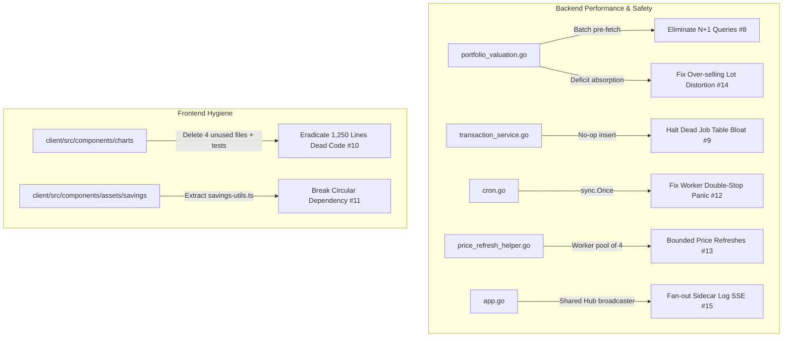

# Implementation Plan: Fix All 8 "Should Fix" Audit Issues

This plan addresses all 8 "Should Fix" issues (Items 8–15) identified in the repository audit across backend services, GraphQL helpers, background workers, and frontend React components.

---

## 1. Goal Description

Following the successful resolution of all 7 critical "Must Fix" items in commit `602057f`, this plan targets architectural hygiene, memory/channel safety, N+1 query elimination, accounting deficit handling, dead code eradication, and SSE polling resource efficiency.

---

## 2. User Review & Resolved Decisions

> [!IMPORTANT]
> **Resolved Architectural Decisions (via `/grill-me`)**:
> 1. **Over-Selling Lot Deficit (Item 14)**: **Deficit Absorption (FIFO)**. When transactions are recorded out-of-order (sale before purchase), the unfulfilled sale quantity is tracked as an `oversoldDeficit`. Subsequent buy transactions first satisfy this deficit before creating any new cost lots, preventing phantom lot inflation.
> 2. **Dead Recalculation Enqueue (Item 9)**: **No-op the Function**. Replace the raw SQL insert in `transaction_service.go:enqueuePortfolioRecalculation` with a no-op trace (`[DEBUG] [portfolio-materialization] recalculation enqueue skipped (worker not active)`), leaving the schema intact for future background worker development.
> 3. **Market Data Price Refresh (Item 13)**: **Dynamic Batching**. Group incoming asset IDs over a 500ms window into a deduplicated batch call, preventing external API saturation and eliminating unbounded goroutine spawning.
> 4. **Dead Demo Charts Deletion (Item 10)**: Delete 4 unused demo chart components (`ChartExamples.tsx`, `DashboardIntegrationExample.tsx`, `CompactCharts.tsx`, `ChartInteractions.tsx`) and the failing test file `inline-dashboard-charts.test.tsx` (-1,250 lines).
> 5. **Batch Valuation Pre-fetching (Item 8)**: Pre-fetch latest prices, assets, instruments, and transactions in 4 queries instead of $4N$ queries inside `CalculatePortfolioValue`.
> 6. **Sidecar SSE Broadcasting (Item 15)**: Implement a shared hub per sidecar that polls at 1 Hz only when active subscribers exist.
> 7. **Commit Structure**: All 8 items executed, verified across frontend and backend, and committed together in a single consolidated commit.

---

## 3. Proposed Changes



---

### Component 1: Portfolio Valuation (Items 8 & 14)

#### [MODIFY] [`server/internal/service/portfolio_valuation.go`](file:///home/dev/repos/sigma-finance/server/internal/service/portfolio_valuation.go)
1. **Item 8 (N+1 Query Elimination)**:
   - In `CalculatePortfolioValue(ctx, positions, displayCurrency)`:
     - Collect unique `assetIDs` and `positionIDs`.
     - Batch fetch latest prices via `s.uow.AssetPrice().GetLatestPrices(ctx, assetIDs)` into a lookup map `map[string]*model.AssetPrice`.
     - Batch fetch assets via `s.uow.Asset().FindAllBy(ctx, ...)` into `map[string]*model.Asset`.
     - Collect referenced `instrumentIDs` and batch fetch instruments via `s.uow.Instrument().FindAllBy(ctx, ...)`.
     - Batch fetch all transactions across positions via `s.uow.Transaction().FindAllBy(ctx, ...)` into `map[string][]*model.Transaction`.
     - Pass the pre-fetched maps into an internal helper `calculatePositionValueWithCache`, avoiding any database round-trips during the position loop.
2. **Item 14 (Oversold Deficit Absorption)**:
   - In `remainingCostLots`:
     - Introduce `oversoldDeficit := decimal.Zero`.
     - When a sell or transfer-out exceeds available lots:
       - Add unfulfilled quantity to `oversoldDeficit`.
       - Log a warning with position ID, tx ID, deficit amount, and execution date.
     - When subsequent buy or transfer-in transactions arrive:
       - If `oversoldDeficit.IsPositive()`:
         - If buy quantity <= deficit: reduce deficit by buy quantity and do not add a lot (it backfilled the short position).
         - If buy quantity > deficit: add lot with `Quantity = buy.Quantity - deficit`, and reset deficit to zero.

#### [MODIFY] [`server/internal/service/portfolio_valuation_test.go`](file:///home/dev/repos/sigma-finance/server/internal/service/portfolio_valuation_test.go)
- Add unit tests verifying:
  - Batch pre-fetching computes identical valuations to individual evaluations without redundant queries.
  - Out-of-order sell transactions (sell executed before buy is recorded) track oversold deficit and absorb subsequent buys correctly without creating inflated phantom lots.

---

### Component 2: Transaction Service (Item 9)

#### [MODIFY] [`server/internal/service/transaction_service.go`](file:///home/dev/repos/sigma-finance/server/internal/service/transaction_service.go)
- In `enqueuePortfolioRecalculation`:
  - Replace the dead SQL `INSERT INTO sigma_finance.portfolio_recalculation_jobs` with a no-op / logged trace comment indicating background recalculation worker is not yet activated.
  - This stops accumulating unread rows in `portfolio_recalculation_jobs` on every transaction create/delete/process.

---

### Component 3: Dead Client Chart Components (Item 10)

#### [DELETE] `client/src/components/charts/ChartExamples.tsx`
#### [DELETE] `client/src/components/charts/DashboardIntegrationExample.tsx`
#### [DELETE] `client/src/components/charts/CompactCharts.tsx`
#### [DELETE] `client/src/components/charts/ChartInteractions.tsx`
#### [DELETE] `client/src/components/charts/__tests__/inline-dashboard-charts.test.tsx`

#### [MODIFY] [`client/src/components/charts/index.ts`](file:///home/dev/repos/sigma-finance/client/src/components/charts/index.ts)
- Remove export statements for `ChartExamples`, `DashboardIntegrationExample`, `CompactCharts`, and `ChartInteractions`.

#### [MODIFY] [`client/src/components/charts/README.md`](file:///home/dev/repos/sigma-finance/client/src/components/charts/README.md)
- Update documentation to remove references to the deleted example components.

---

### Component 4: Savings Module Circular Dependency (Item 11)

#### [NEW] `client/src/components/assets/savings/savings-utils.ts`
- Extract `resolveBankName`, `resolveCategoryLabel`, and their auxiliary helper regexes/interfaces from `SavingsList.tsx`.

#### [MODIFY] [`client/src/components/assets/savings/SavingsList.tsx`](file:///home/dev/repos/sigma-finance/client/src/components/assets/savings/SavingsList.tsx)
- Re-export or import `resolveBankName` and `resolveCategoryLabel` from `./savings-utils`.

#### [MODIFY] [`client/src/components/assets/savings/SavingDetail.tsx`](file:///home/dev/repos/sigma-finance/client/src/components/assets/savings/SavingDetail.tsx)
- Change import of `resolveBankName` and `resolveCategoryLabel` to point to `./savings-utils` instead of `./SavingsList`.

---

### Component 5: Background Wallet Sync Worker (Item 12)

#### [MODIFY] [`server/internal/service/sync/blockchain/cron.go`](file:///home/dev/repos/sigma-finance/server/internal/service/sync/blockchain/cron.go)
- Add `stopOnce sync.Once` field to `BackgroundSyncWorker`.
- In `Stop()`:
  ```go
  func (w *BackgroundSyncWorker) Stop() {
      w.stopOnce.Do(func() {
          close(w.stopChan)
      })
  }
  ```

#### [NEW] `server/internal/service/sync/blockchain/cron_test.go`
- Add unit test verifying that calling `worker.Stop()` repeatedly (2+ times concurrently or sequentially) terminates cleanly without panicking.

---

### Component 6: Market Data Price Refresh Helper (Item 13)

#### [MODIFY] [`server/internal/handler/graphql/price_refresh_helper.go`](file:///home/dev/repos/sigma-finance/server/internal/handler/graphql/price_refresh_helper.go)
- Create a bounded queue & worker pool:
  - `var priceRefreshChan chan priceRefreshTask` (buffer capacity 100).
  - `var initPriceRefreshWorkersOnce sync.Once`.
  - Fixed concurrency pool (e.g. 3 worker goroutines) reading from `priceRefreshChan`.
  - In `triggerAssetPriceRefresh`:
    - Perform non-blocking send `select { case priceRefreshChan <- task: default: log.Printf("[WARN] price refresh queue full, dropping asset=%s", asset.ID) }`.
  - Workers run `UpdateAssetPrice` with a 2-minute context timeout.

---

### Component 7: Sidecar Log SSE Proxy (Item 15)

#### [MODIFY] [`server/cmd/app.go`](file:///home/dev/repos/sigma-finance/server/cmd/app.go)
- Replace per-connection HTTP polling with a shared `sidecarLogHub`:
  - Maintains `map[string]*sidecarPoller` keyed by service name (`yfinance`, `woob`).
  - Poller runs a single 1-second ticker fetching upstream logs when `subscriberCount > 0`.
  - Fans out new entries to connected client channels.
  - When no clients are subscribed, polling halts.
  - `handleSidecarLogSSE` subscribes to the hub channel, streams incoming entries to the HTTP response, and unsubscribes on client disconnect.

---

## 4. Verification Plan

### Automated Tests
1. **Server Unit & Service Tests**:
   ```bash
   cd server && TEST_DB_HOST=192.168.1.170 TEST_DB_PASSWORD="xQxW&yATWuC2N3*8" go test -v ./internal/service/... ./internal/handler/graphql/... ./internal/service/sync/blockchain/... ./cmd/...
   ```
2. **Client Typecheck & Vitest Suite**:
   ```bash
   cd client && npm run typecheck && npx vitest run
   ```
3. **Container Rebuild & Health Check**:
   ```bash
   docker compose build server && docker compose up -d server
   curl -s -X POST http://localhost:8080/graphql -H "Content-Type: application/json" -d '{"query":"{ __typename }"}'
   ```

### Manual Verification
- Verify sidecar logs SSE streaming continues to function properly on the admin log viewer without multiple HTTP polling loops.
- Verify savings overview and detail dialog open and interact smoothly without circular import warnings.
- Confirm dashboard portfolio valuation renders correctly.
