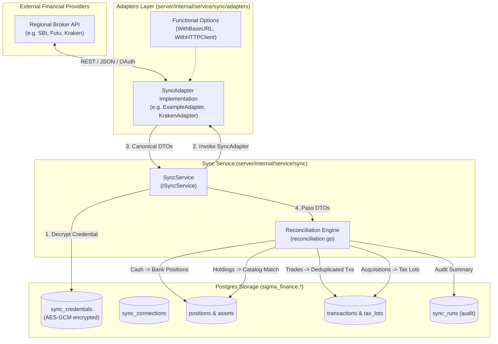

# Regional Sync Adapter Developer Guide & Extension SDK

Welcome to the SigmaFinance Synchronization Engine extension guide. This document provides open-source contributors with everything needed to build, test, and register new regional sync adapters for brokers, crypto exchanges, and Open Banking providers worldwide.

Whether you are adding support for **Japan** (*SBI Securities*, *Rakuten Securities*, *bitFlyer*, *Monex*), **Greater China** (*Futu OpenAPI / Moomoo*, *Tiger Brokers TigerOpen*), the **United States** (*Interactive Brokers*, *Plaid*, *Coinbase*), or other regional institutions, this guide explains the architectural standards, normalized data contracts, monetary precision rules, and testing patterns required.

A complete, fully compilable reference template is available at [`server/internal/service/sync/adapters/example_adapter.go`](file:///home/dev/repos/sigma-finance/server/internal/service/sync/adapters/example_adapter.go).

---

## Table of Contents

1. [Architecture Overview](#1-architecture-overview)
2. [The SyncAdapter Interface](#2-the-syncadapter-interface)
3. [Normalized Data Transfer Objects (DTOs)](#3-normalized-data-transfer-objects-dtos)
4. [Financial Precision & Currency Rules](#4-financial-precision--currency-rules)
5. [Error Handling & Resilience](#5-error-handling--resilience)
6. [Instrument Resolution & Ticker Mapping](#6-instrument-resolution--ticker-mapping)
7. [Unit Testing Guidelines](#7-unit-testing-guidelines)
8. [Step-by-Step Implementation Tutorial](#8-step-by-step-implementation-tutorial)
9. [Registration & Integration](#9-registration--integration)
10. [Contributor Pull Request Checklist](#10-contributor-pull-request-checklist)

---

## 1. Architecture Overview

SigmaFinance uses a decoupled, event-driven account synchronization engine designed for clean data isolation, idempotent writes, and unified portfolio reconciliation.

### Architecture Flow



### The Reconciliation Pipeline

When a sync run is triggered for a connection, the `SyncService` coordinates with the adapter and reconciliation engine:

1. **Credential Decryption**: AES-GCM encrypted credentials stored in `sync_credentials` are decrypted in-memory using `cred.Decrypt()`.
2. **Account Discovery (`FetchAccounts`)**: The adapter queries external accounts. If the connection does not yet have a linked SigmaFinance account, one can be automatically provisioned.
3. **Cash Balance Reconciliation (`FetchBalances` -> `ReconcileBalances`)**: Uninvested cash balances are converted into synthetic `AssetTypeBankAccount` positions with real-time price records.
4. **Holdings Reconciliation (`FetchHoldings` -> `ReconcileHoldings`)**:
   - Each holding is matched against the Instrument Catalog via a 3-tier lookup: local asset symbol $\rightarrow$ global ISIN $\rightarrow$ instrument search index.
   - If an asset cannot be matched, an `UNMAPPED` placeholder asset is automatically created so sync runs **never fail or drop holdings**.
   - Active position quantities and cost bases are updated.
5. **Position Liquidation (`ReconcileLiquidatedPositions`)**: Any security previously held in the account that is missing from the incoming snapshot is updated to `quantity = 0` (marking the position closed/liquidated).
6. **Transaction Ingestion (`FetchTransactions` -> `ReconcileTransactions`)**:
   - Trades, deposits, withdrawals, dividends, and fees are ingested with idempotent deduplication based on `(account_id, external_id)`.
   - BUY transactions automatically generate open tax lots.
7. **Residual Tax Lot Generation (`ReconcileResidualTaxLots`)**:
   - For positions where the authoritative holdings snapshot exceeds historical buy transactions (e.g. transfers in, or history older than the provider's transaction window), baseline opening tax lots are synthesized to maintain cost-basis continuity.
8. **Audit Logging**: A `model.SyncRun` audit record captures the run status, execution duration, items imported/updated, and warnings.

---

## 2. The SyncAdapter Interface

Every adapter must satisfy the `SyncAdapter` interface declared in [`server/internal/service/sync/adapter.go`](file:///home/dev/repos/sigma-finance/server/internal/service/sync/adapter.go):

```go
type SyncAdapter interface {
    // Provider returns the immutable uppercase provider identifier (e.g. "KRAKEN", "SBI_SECURITIES").
    Provider() string

    // TestConnection validates that external credentials are functional (e.g. pinging a profile endpoint).
    TestConnection(ctx context.Context, cred *model.SyncCredential) error

    // FetchAccounts discovers legal sub-accounts accessible under these credentials.
    FetchAccounts(ctx context.Context, cred *model.SyncCredential) ([]RawAccount, error)

    // FetchBalances queries uninvested cash and buying power for a specific account.
    FetchBalances(ctx context.Context, cred *model.SyncCredential, externalAccountID string) ([]RawBalance, error)

    // FetchHoldings queries security and crypto positions currently held in the account.
    FetchHoldings(ctx context.Context, cred *model.SyncCredential, externalAccountID string) ([]RawHolding, error)

    // FetchTransactions queries executed trades, cash flows, and fees. Supports incremental sync via 'since'.
    FetchTransactions(ctx context.Context, cred *model.SyncCredential, externalAccountID string, since *time.Time) ([]RawTransaction, error)
}
```

### Interface Contracts & Idempotence Guarantees

- **Context Propagation**: Always pass `ctx` to all outbound HTTP requests (`http.NewRequestWithContext(ctx, ...)`). If the context is canceled or times out, return `ctx.Err()`.
- **Read-Only / Side-Effect Free**: Adapters must never place orders, mutate positions, or submit transactions externally. They are read-only collectors.
- **Fail Gracefully**: If an optional field is missing from a vendor payload (e.g. ISIN or notes), omit it or use safe fallbacks rather than failing the entire fetch.

---

## 3. Normalized Data Transfer Objects (DTOs)

Adapters translate vendor-specific payloads into four canonical structs:

### 1. `RawAccount`

Represents an individual custodial or legal sub-account (e.g., standard brokerage, Japanese NISA, UK ISA, cash checking).

| Field | Type | Description | Required? |
| :--- | :--- | :--- | :--- |
| `ExternalID` | `string` | Unique identifier assigned by the provider (e.g. `"acc-84920"`) | **Yes** |
| `Name` | `string` | Human-readable account label (e.g. `"NISA Growth Account"`) | **Yes** |
| `Type` | `model.AccountType` | `AccountTypeBroker`, `AccountTypeBank`, `AccountTypeCryptoExchange` | **Yes** |
| `TaxWrapper` | `model.TaxWrapperType` | `TaxWrapperStandardTaxable`, `TaxWrapperRetirementSheltered`, `TaxWrapperPEA`, `TaxWrapperCryptoVault` | **Yes** |
| `Institution` | `string` | Name of the financial institution (e.g. `"SBI Securities"`) | **Yes** |
| `AccountNumber`| `string` | Masked or public account number (e.g. `"****-5678"`) | **Yes** |
| `Currency` | `model.Currency` | Base currency of the account (`"USD"`, `"EUR"`, `"GBP"`, `"JPY"`, etc.) | **Yes** |

### 2. `RawBalance`

Represents cash holdings under an account (one entry per fiat or settlement currency).

| Field | Type | Description | Required? |
| :--- | :--- | :--- | :--- |
| `Currency` | `model.Currency` | Fiat currency code (e.g. `model.CurrencyUSD`, `model.Currency("JPY")`) | **Yes** |
| `Amount` | `decimal.Decimal`| Total settled cash balance | **Yes** |
| `Available` | `*decimal.Decimal`| Unsettled/buying power available for withdrawal or trading | Optional |

### 3. `RawHolding`

Represents an open position in an equity, ETF, mutual fund, or cryptocurrency.

| Field | Type | Description | Required? |
| :--- | :--- | :--- | :--- |
| `ExternalID` | `string` | Unique holding/position ID from the broker | Optional |
| `Symbol` | `string` | Ticker symbol (e.g. `"7203"` for Toyota, `"9988"` for Alibaba, `"AAPL"`, `"BTC"`) | **Yes** |
| `Name` | `string` | Descriptive asset name | Optional |
| `ISIN` | `string` | 12-character International Securities ID (e.g. `"JP3633400001"`) | Highly Recommended |
| `AssetType` | `model.AssetType` | `AssetTypeStock`, `AssetTypeFund`, `AssetTypeCrypto`, `AssetTypeBankAccount` | **Yes** |
| `Quantity` | `decimal.Decimal`| Fractional or whole units held (must be $> 0$) | **Yes** |
| `CostBasisPerUnit` | `*decimal.Decimal` | Average acquisition cost per unit in quote currency | Optional |
| `TotalCostBasis` | `*model.Money` | Total acquisition cost in **integer cents** (scaled by 100) | Optional |
| `CurrentPrice` | `*decimal.Decimal` | Latest market price in quote currency | Optional |
| `Currency` | `model.Currency` | Quote currency of the position | **Yes** |

> [!TIP]
> **ISINs are Gold**: If the broker API provides ISINs, always pass them. ISIN matching directly links positions to historical price packs and company fundamentals in the SigmaFinance Instrument Catalog.

### 4. `RawTransaction`

Represents an executed order, dividend payment, cash deposit/withdrawal, or fee.

| Field | Type | Description | Required? |
| :--- | :--- | :--- | :--- |
| `ExternalID` | `string` | Unique transaction ID used for atomic database deduplication | **Yes** |
| `Type` | `model.TransactionType`| `TransactionTypeBuy`, `TransactionTypeSell`, `TransactionTypeDeposit`, `TransactionTypeWithdrawal`, `TransactionTypeDividend`, `TransactionTypeFee` | **Yes** |
| `Symbol` | `string` | Associated ticker symbol (empty for non-trade cash flows) | Optional |
| `Name` | `string` | Transaction description / notes | Optional |
| `ISIN` | `string` | Associated ISIN | Optional |
| `Quantity` | `*decimal.Decimal`| Number of units traded | Optional |
| `UnitPriceAmount` | `*decimal.Decimal`| Price per unit at execution | Optional |
| `UnitPriceCurrency`| `model.Currency` | Currency of unit price | Optional |
| `Amount` | `model.Money` | Total transaction value in **integer cents** (scaled by 100) | **Yes** |
| `Currency` | `model.Currency` | Settlement currency | **Yes** |
| `FeesAmount` | `model.Money` | Brokerage or exchange fees in **integer cents** | Optional |
| `FeesCurrency` | `model.Currency` | Fee currency | Optional |
| `ExecutedAt` | `time.Time` | Timestamp when the transaction settled or executed | **Yes** |
| `Notes` | `string` | Additional transaction notes or memo | Optional |

---

## 4. Financial Precision & Currency Rules

Financial software requires zero tolerance for floating-point inaccuracies. Adhere strictly to the following rules:

### Money vs. Decimal Decision Matrix

| Data Concept | Type | Implementation & Conversion |
| :--- | :--- | :--- |
| **Monetary values** (prices, settlement totals, fees, cost basis) | `model.Money` | `int64` representing minor units (cents). Convert with `model.FromDecimal(d)` or `model.FromFloat(f)`. |
| **Asset quantities** (stocks, fractional shares, crypto satoshis) | `decimal.Decimal` | `github.com/shopspring/decimal.Decimal`. Parse with `decimal.NewFromString(s)`. |
| **Unit prices** (per-share or per-token prices) | `decimal.Decimal` | Allows sub-cent precision on micro-shares and crypto rates. |

```go
// Correct: Convert decimal cost to model.Money
totalCostDec := decimal.NewFromFloat(1250.75)
totalCostCents := model.FromDecimal(totalCostDec) // model.Money(125075)

// Incorrect: NEVER use float arithmetic for currency balances
badTotal := float64(1250.75) * 100.0 // Vulnerable to IEEE-754 precision drift
```

### Zero-Decimal Currencies (JPY, KRW)

Most global currencies (USD, EUR, GBP, CNY, HKD) have 100 minor units per major unit ($1.00 = 100$ cents). However, currencies like the Japanese Yen (JPY) and Korean Won (KRW) do not traditionally have minor subdivisions.

In SigmaFinance:
- The internal `model.Money` type represents **scaled minor units ($10^{-2}$)** across the entire database to ensure arithmetic consistency across multi-currency portfolios.
- When an adapter parses a JPY amount (e.g. $¥250,000$), scale by 100 to produce cents:
  ```go
  // ¥250,000 becomes model.Money(25000000)
  jpyDec := decimal.RequireFromString("250000")
  jpyCents := model.FromDecimal(jpyDec)
  ```
- When displaying or reporting in JPY, the UI and API layer handles presentation formatting.

### Currency Normalization Matrix

Adapters must normalize raw currency strings using an idempotent helper function:

```go
func NormalizeCurrency(raw string) model.Currency {
    c := strings.ToUpper(strings.TrimSpace(raw))
    switch c {
    case "USD", "$", "US_DOLLAR":
        return model.CurrencyUSD
    case "EUR", "€", "EURO":
        return model.CurrencyEUR
    case "GBP", "£", "STERLING":
        return model.CurrencyGBP
    case "JPY", "¥", "YEN":
        return model.Currency("JPY")
    case "CNY", "RMB", "YUAN":
        return model.Currency("CNY")
    case "HKD", "HK$":
        return model.Currency("HKD")
    case "CAD", "C$":
        return model.Currency("CAD")
    case "AUD", "A$":
        return model.Currency("AUD")
    case "CHF":
        return model.Currency("CHF")
    default:
        if len(c) == 3 {
            return model.Currency(c)
        }
        return model.CurrencyUSD
    }
}
```

> [!NOTE]
> `model.CurrencyUSD`, `model.CurrencyEUR`, and `model.CurrencyGBP` are primary native currencies enforced by PostgreSQL check constraints on `transactions` and `user`. Regional currencies like `JPY`, `CNY`, and `HKD` are fully supported in holding quotes and asset metadata. If your regional adapter requires adding native database transaction constraints for a new currency, see [Section 9](#9-registration--integration).

---

## 5. Error Handling & Resilience

The reconciliation engine uses standard sentinel errors to distinguish between transient failures, security revocations, and rate limits. Adapters must map external vendor HTTP codes and error bodies into these sentinels:

```go
import syncservice "sigma_finance/internal/service/sync"
```

### Sentinel Error Mapping

| HTTP Code | Vendor Pattern | Mapped Sentinel Error | Engine Reaction |
| :--- | :--- | :--- | :--- |
| **401 Unauthorized** / **403 Forbidden** | `"invalid_key"`, `"invalid_signature"`, `"token_rejected"` | `syncservice.ErrInvalidCredentials` | Marks `SyncCredential` as `INVALID`; halts sync; alerts user to reconnect |
| **429 Too Many Requests** | `"rate_limit_exceeded"`, `"throttled"`, `"too_many_requests"` | `syncservice.ErrRateLimited` | Marks run as retryable; preserves credential status |
| **Expired OAuth Token** | `"token_expired"`, `"invalid_grant"` | `syncservice.ErrExpiredCredentials` | Attempts token refresh if supported; else marks `EXPIRED` |
| **5xx Server Error** | Transient downstream outage | Wrapped `fmt.Errorf("vendor error: %w", err)` | Logs failure in `SyncRun`; does not invalidate credentials |

### Error Parsing Pattern

```go
func (a *MyAdapter) parseResponseError(resp *http.Response, body []byte) error {
    if resp.StatusCode == http.StatusTooManyRequests {
        return syncservice.ErrRateLimited
    }
    if resp.StatusCode == http.StatusUnauthorized || resp.StatusCode == http.StatusForbidden {
        return syncservice.ErrInvalidCredentials
    }

    var payload struct {
        Code    string `json:"code"`
        Message string `json:"message"`
    }
    if err := json.Unmarshal(body, &payload); err == nil {
        msgLower := strings.ToLower(payload.Code + " " + payload.Message)
        if strings.Contains(msgLower, "rate limit") || strings.Contains(msgLower, "throttled") {
            return syncservice.ErrRateLimited
        }
        if strings.Contains(msgLower, "unauthorized") || strings.Contains(msgLower, "invalid api key") {
            return syncservice.ErrInvalidCredentials
        }
        return fmt.Errorf("provider api error (%d): %s", resp.StatusCode, payload.Message)
    }

    return fmt.Errorf("provider api error (%d): %s", resp.StatusCode, string(body))
}
```

---

## 6. Instrument Resolution & Ticker Mapping

Regional markets use different ticker conventions. For example:
- **Japan (Tokyo Stock Exchange)**: 4-digit numerical tickers (e.g. `7203` for Toyota, `9984` for SoftBank).
- **China (SSE / SZSE)**: 6-digit numeric tickers (e.g. `600519` for Kweichow Moutai, `000001` for Ping An Bank).
- **Hong Kong (HKEX)**: 4 or 5-digit codes (e.g. `0700` or `00700` for Tencent, `9988` for Alibaba).
- **Crypto**: Standardized pairs (e.g. `BTC`, `ETH`, `SOL`).

### Resolution Best Practices

1. **Populate `ISIN` whenever available**: ISINs provide an unambiguous, exchange-independent key.
2. **Clean Tickers**: Strip exchange suffixes if they are vendor-specific artifacts unless required to disambiguate. For example:
   ```go
   // Normalize "7203.T" or "7203.JP" to standard TSE "7203"
   func cleanTSETicker(raw string) string {
       return strings.TrimSuffix(strings.TrimSuffix(raw, ".T"), ".JP")
   }
   ```
3. **Graceful Fallback**: If an instrument is not currently in the SigmaFinance Instrument Catalog, the reconciliation engine automatically provisions an `UNMAPPED` placeholder. Your adapter should still populate `Symbol`, `Name`, and `AssetType`.

---

## 7. Unit Testing Guidelines

All adapter code in SigmaFinance must be backed by comprehensive unit tests that execute in **milliseconds** without external network dependencies.

### 1. Hermetic Testing with `httptest.Server`

Never make outbound HTTP calls in tests. Spin up an in-process `httptest.Server`:

```go
func TestMyAdapter_FetchAccounts_Success(t *testing.T) {
    server := httptest.NewServer(http.HandlerFunc(func(w http.ResponseWriter, r *http.Request) {
        assert.Equal(t, "/v1/accounts", r.URL.Path)
        assert.Equal(t, "my-api-key", r.Header.Get("X-API-Key"))

        w.Header().Set("Content-Type", "application/json")
        w.WriteHeader(http.StatusOK)
        _, _ = w.Write([]byte(`{
            "accounts": [
                {
                    "id": "acc-101",
                    "name": "General Brokerage",
                    "type": "broker",
                    "tax_category": "standard",
                    "institution": "SBI Securities",
                    "account_number": "1234-5678",
                    "currency": "JPY"
                }
            ]
        }`))
    }))
    defer server.Close()

    adapter := NewMyAdapter(
        WithBaseURL(server.URL),
        WithHTTPClient(server.Client()),
    )

    cred := makeTestCredential("my-api-key", "my-secret")
    accounts, err := adapter.FetchAccounts(context.Background(), cred)

    require.NoError(t, err)
    require.Len(t, accounts, 1)
    assert.Equal(t, "acc-101", accounts[0].ExternalID)
    assert.Equal(t, model.Currency("JPY"), accounts[0].Currency)
}
```

### 2. Functional Options Pattern

Every adapter constructor accepts `...Option` functions so test fixtures can inject custom URLs and clients:

```go
type MyAdapterOption = Option

func NewMyAdapter(opts ...Option) *MyAdapter {
    a := &MyAdapter{
        baseURL: defaultBaseURL,
        httpClient: &http.Client{Timeout: 30 * time.Second},
    }
    for _, opt := range opts {
        opt(a)
    }
    return a
}
```

In `server/internal/service/sync/adapters/options.go`, add your adapter type to the type switch:

```go
func WithBaseURL(baseURL string) Option {
    return func(target any) {
        switch t := target.(type) {
        case *KrakenAdapter:
            t.baseURL = strings.TrimRight(baseURL, "/")
        case *MyAdapter:
            t.baseURL = strings.TrimRight(baseURL, "/")
        }
    }
}
```

### 3. Required Test Scenarios

Every new adapter must include unit tests verifying:
- [x] **Connection Success**: HTTP 200 OK ping returns `nil`.
- [x] **Rate Limit Error**: HTTP 429 returns `syncservice.ErrRateLimited`.
- [x] **Authentication Error**: HTTP 401/403 returns `syncservice.ErrInvalidCredentials`.
- [x] **Malformed / Truncated JSON**: Graceful unmarshaling failure.
- [x] **Holdings Mapping**: Correct extraction of `decimal.Decimal` quantities and `model.Money` cost basis.
- [x] **Transaction Mapping**: Parsing trades, chronological sorting, and `since` date filtering.
- [x] **Currency Normalization**: Table-driven test verifying regional currency mappings.

---

## 8. Step-by-Step Implementation Tutorial

Let's walk through building a new regional adapter for a Japanese broker: `SBISecuritiesAdapter`.

### Step 1: Create the Adapter File

Create `server/internal/service/sync/adapters/sbi_securities.go`:

```go
package adapters

import (
    "context"
    "encoding/json"
    "fmt"
    "net/http"
    "strings"
    "time"

    "github.com/shopspring/decimal"
    "sigma_finance/internal/domain/model"
    syncservice "sigma_finance/internal/service/sync"
)

const (
    SyncProviderSBISecurities = "SBI_SECURITIES"
    defaultSBIBaseURL         = "https://api.sbisec.co.jp"
)

type SBISecuritiesAdapter struct {
    baseURL    string
    httpClient *http.Client
}

func NewSBISecuritiesAdapter(opts ...Option) *SBISecuritiesAdapter {
    a := &SBISecuritiesAdapter{
        baseURL: defaultSBIBaseURL,
        httpClient: &http.Client{Timeout: 30 * time.Second},
    }
    for _, opt := range opts {
        opt(a)
    }
    return a
}

func (a *SBISecuritiesAdapter) Provider() string {
    return SyncProviderSBISecurities
}
```

### Step 2: Implement Credential Parsing

```go
type sbiCredentials struct {
    CustomerID string `json:"customer_id"`
    APIKey     string `json:"api_key"`
    APISecret  string `json:"api_secret"`
}

func parseSBICredentials(cred *model.SyncCredential) (*sbiCredentials, error) {
    if cred == nil {
        return nil, syncservice.ErrInvalidCredentials
    }
    rawJSON, err := cred.Decrypt()
    if err != nil || strings.TrimSpace(rawJSON) == "" {
        return nil, fmt.Errorf("%w: failed to decrypt credential", syncservice.ErrInvalidCredentials)
    }
    var parsed sbiCredentials
    if err := json.Unmarshal([]byte(rawJSON), &parsed); err != nil {
        return nil, fmt.Errorf("%w: invalid credential JSON", syncservice.ErrInvalidCredentials)
    }
    if parsed.APIKey == "" || parsed.APISecret == "" {
        return nil, fmt.Errorf("%w: missing api_key or api_secret", syncservice.ErrInvalidCredentials)
    }
    return &parsed, nil
}
```

### Step 3: Implement `TestConnection` and `FetchAccounts`

```go
func (a *SBISecuritiesAdapter) TestConnection(ctx context.Context, cred *model.SyncCredential) error {
    creds, err := parseSBICredentials(cred)
    if err != nil {
        return err
    }
    // Issue test ping request
    return a.doPing(ctx, creds)
}

func (a *SBISecuritiesAdapter) FetchAccounts(ctx context.Context, cred *model.SyncCredential) ([]syncservice.RawAccount, error) {
    creds, err := parseSBICredentials(cred)
    if err != nil {
        return nil, err
    }

    // Call SBI account discovery endpoint
    // Map accounts to syncservice.RawAccount with model.Currency("JPY")
    return accounts, nil
}
```

### Step 4: Implement `FetchBalances`, `FetchHoldings`, and `FetchTransactions`

Follow the reference implementation in [`example_adapter.go`](file:///home/dev/repos/sigma-finance/server/internal/service/sync/adapters/example_adapter.go). Ensure:
- Holdings cost basis is converted to integer cents using `model.FromDecimal(...)`.
- Transactions are chronologically sorted by `ExecutedAt`.
- Quantities use `decimal.Decimal`.

---

## 9. Registration & Integration

To make the new adapter available to the application:

1. **Add Provider Constant** in `server/internal/domain/model/sync.go`:
   ```go
   const (
       SyncProviderKraken        = "KRAKEN"
       SyncProviderSnapTrade     = "SNAPTRADE"
       SyncProviderGoCardless    = "GOCARDLESS"
       SyncProviderSBISecurities = "SBI_SECURITIES" // Added
       SyncProviderManual        = "MANUAL"
   )
   ```

2. **Register Functional Options** in `server/internal/service/sync/adapters/options.go`:
   Add `*SBISecuritiesAdapter` to `WithBaseURL` and `WithHTTPClient`.

3. **Register Adapter with SyncService** in server startup (e.g. `server/cmd/bun/main.go` or app initialization):
   ```go
   sbiAdapter := adapters.NewSBISecuritiesAdapter()
   syncService.RegisterAdapter(sbiAdapter)
   ```

4. **Add Unit Tests**: Create `server/internal/service/sync/adapters/sbi_securities_test.go` and verify all scenarios pass.

---

## 10. Contributor Pull Request Checklist

Before opening a pull request with your new regional adapter, ensure each of the following requirements is met:

- [ ] **Implementation**: Adapter satisfies `syncservice.SyncAdapter` interface in full.
- [ ] **Precision**: All quantities are `decimal.Decimal`; all monetary values and fees are `model.Money` in integer cents.
- [ ] **Currency Normalization**: Regional currency strings normalized cleanly (JPY, CNY, HKD, etc.).
- [ ] **Error Mapping**: HTTP 429 maps to `ErrRateLimited`; HTTP 401/403 maps to `ErrInvalidCredentials`.
- [ ] **Security**: Credentials decrypted strictly in-memory via `cred.Decrypt()`. Zero secrets in error messages or logs.
- [ ] **Testing**: Complete unit test file with table-driven tests and `httptest.Server`.
- [ ] **No Live Network Calls**: Tests run completely offline and finish in $< 100$ms.
- [ ] **Formatting**: Code formatted with `go fmt` and clean of linter warnings.
- [ ] **Clean Test Suite**: All tests pass:
  ```bash
  cd server && go test -v ./internal/service/sync/...
  ```

Thank you for helping make SigmaFinance the most versatile and comprehensive personal portfolio tracker in the world! If you have questions or need guidance, reach out to the core maintainers on GitHub.
